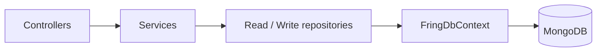

# FringApp

A small ASP.NET Core Web API for a coffee-shop subscription app (users, stores, products, billing), backed by MongoDB.

> **📦 Archived** — this is a learning project from 2023, kept for reference. It is not maintained and is not production-ready.


## Overview

FringApp models the back end of a coffee chain with a subscription offering. It exposes REST endpoints for user management, subscriptions and billing, and seeds MongoDB with sample stores (with attributes such as Wifi / Terrace / Car Park), categories, products and product variants (size, temperature, milk option) on first start.

Implemented endpoints:

| Method | Route | Description |
|---|---|---|
| `POST` | `/api/v1/user/create` | Create a user (validated with FluentValidation) |
| `GET` | `/api/v1/user/{userId}` | Get a user |
| `DELETE` | `/api/v1/user/{userId}` | Delete a user |
| `PATCH` | `/api/v1/user/UnSubscribe/{userId}` | Cancel a user's subscription |
| `GET` | `/api/v1/subscription/{userId}/CurrentSubscription` | Current subscription of a user |
| `GET` | `/api/v1/subscription/{userId}/SubscriptionHistories` | Subscription history of a user |
| `GET` | `/api/v1/billing/{userId}` | Billing information of a user |

## Architecture

A single Web API project organised in layers:



- **Generic repositories** — `ReadRepository<T>` / `WriteRepository<T>` with CQRS-style read/write separation, plus a specific repository per entity.
- **FringDbContext** — wraps `IMongoDatabase`, exposes one `IMongoCollection<T>` per entity (names come from `appsettings.json`) and runs the seed on first start.
- **Validation** — FluentValidation auto-validation for request models.

## Tech stack

- .NET 7 / ASP.NET Core Web API
- MongoDB (MongoDB.Driver 2.22)
- FluentValidation 11
- Swagger (Swashbuckle)

## Project structure

```
FringApp.sln
src/FringApp.API/
├── Controllers/     # User, Subscription, Billing endpoints
├── Services/        # User, Subscription, Billing, Store services
├── Repositories/    # Generic + per-entity read/write repositories
├── Data/            # FringDbContext + seed data
├── Entities/        # Mongo documents (User, Store, Product, ...)
├── Models/, Dtos/   # Request models and DTOs
├── Validators/      # FluentValidation validators
└── Settings/        # DatabaseSettings options
```

## Getting started

**Prerequisites**

- .NET 7 SDK (the project targets `net7.0`; newer SDKs can build it, but running requires the .NET 7 runtime or retargeting)
- Docker (for MongoDB)

```bash
# 1. Start MongoDB
docker run -d --name fring-mongo -p 27017:27017 mongo:6

# 2. Run the API
dotnet run --project src/FringApp.API
```

Swagger UI is available at `http://localhost:5167/swagger` in the Development environment. The connection string and collection names are in `src/FringApp.API/appsettings.json`.

## Notes / limitations

- `StoreService` (store listing and filtering by open / wifi / terrace / car park) is implemented but not yet exposed through a controller.
- `Order` entity and `CreateOrderRequest` exist but ordering is not implemented.
- No authentication, no tests.
- .NET 7 is out of support; the project is kept on its original target framework.
